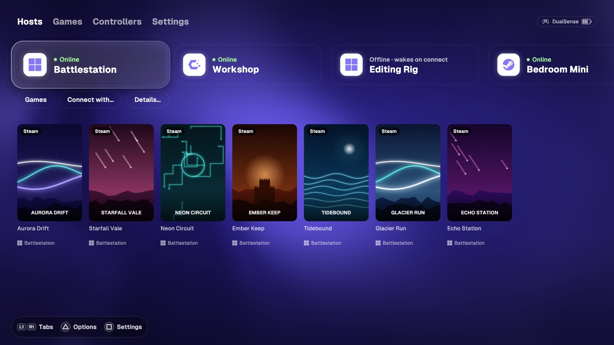
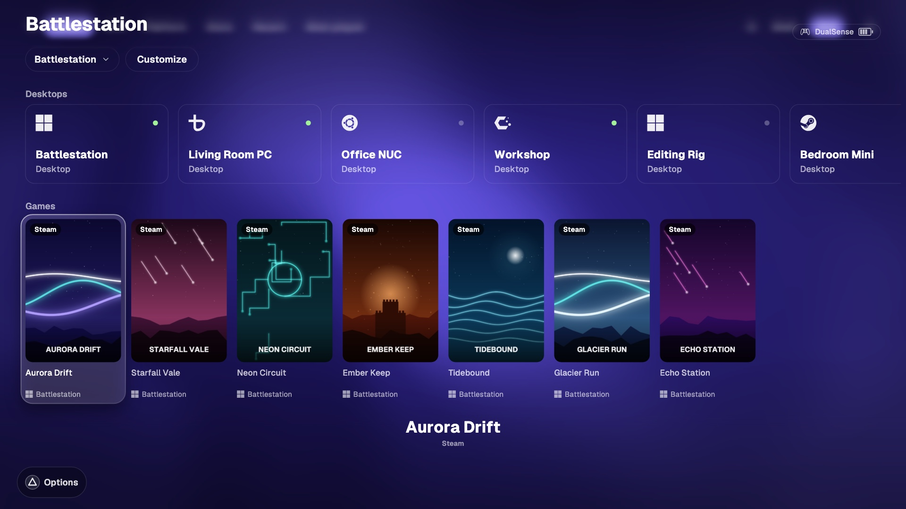
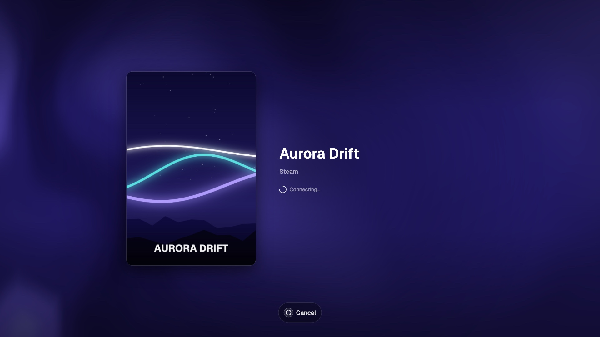

<div align="center">


<br>
<br>

[](https://github.com/punktfunk/client-ps5/actions/workflows/ci.yml)
[](https://github.com/punktfunk/client-ps5/releases)
[](https://github.com/punktfunk/client-ps5/releases)
[](#licence)

**Native PlayStation 5 client for [Punktfunk](https://git.unom.io/unom/punktfunk) — low-latency desktop & game streaming.**

</div>

---

A homebrew title that streams games and desktops from a [Punktfunk](https://docs.punktfunk.unom.io)
host to a PS5, built on the upstream `punktfunk-core` crate (a pinned git dependency — see
`Cargo.toml`) and the shared console UI. This repo is only the PS5-specific client: the console's
platform, Videodec2, a Vulkan presenter on a statically linked RADV, and the title packaging.

> **Early release.** It streams on a tester's PS5 (firmware 13.42); other firmwares, loaders and
> TVs are untested. A release stays a pre-release until a tester has run that build.

<p align="center">
  
</p>
<p align="center">
  
  
</p>

<sub>The interface as this client draws it, rendered on a development machine with sample hosts
and games.</sub>

## Features

What it is built to do:

- 3840×2160 at 59.94 or 119.88 Hz: H.264 and HEVC on the console's decoder, PyroWave on its GPU.
- HDR10 when the display shows HDR and the host sends it.
- The Punktfunk console UI: hosts, pairing, game libraries and settings, driven by the controller.
- DualSense rumble, adaptive triggers, light bar, touchpad and motion, one controller per
  signed-in user.
- Stereo, 5.1 and 7.1 sound.
- A keyboard that types into the host and a controller mouse for its pointer, both in the quick
  menu.

Not yet: DualSense haptics, a USB keyboard or mouse, VRR, and host names (enter an IP address).

## Install it on a console

You need a PS5 that already runs homebrew, with a title loader that registers folders in
`/data/homebrew` and an FTP server, and a [Punktfunk host](https://docs.punktfunk.unom.io/docs/install)
on the same network.

1. Download `PPSA99724.zip` from the [latest release](https://github.com/punktfunk/client-ps5/releases)
   and extract it.
2. Upload the whole `PPSA99724` folder to `/data/homebrew/` over FTP.
3. Wait for your title loader to put **Punktfunk** on the home screen, then launch it and pair
   your host.

[`docs/install.md`](docs/install.md) is the full guide: the first stream, updating, removing, and
what to do when something goes wrong.

In a stream, hold the touchpad click and press Cross for the quick menu. Hold L1 + R1 + Options +
touchpad click for one second to end the stream. The console keeps Create and PS, so hold the
touchpad click and press L3 for Select, or R3 for Guide.

## Help and feedback

Reports from other firmwares, loaders and TVs are what this client needs most.
[Open an issue](https://github.com/punktfunk/client-ps5/issues) or ask on
[Discord](https://discord.gg/wzEGg9y45z);
[`docs/install.md`](docs/install.md#report-a-problem) lists what to include.

## Build it

The client builds, runs and tests on macOS and Linux. The console build runs in Docker.

You need [rustup](https://rustup.rs) (`rust-toolchain.toml` installs the pinned nightly),
[Task](https://taskfile.dev), cmake and clang. On Linux also the packages the `host` job in
[`.github/workflows/ci.yml`](.github/workflows/ci.yml) installs.

```sh
task test    # every test this machine can run
task lint    # rustfmt and clippy -D warnings, as CI runs them
task run     # the client on this machine (PF_PS5_DATA, PF_PS5_SIZE, PF_PS5_PADS)
```

The console build, in the toolchain image. On an Apple Silicon Mac, first
`export DOCKER_DEFAULT_PLATFORM=linux/amd64`.

```sh
task docker:toolchain       # once per pin: SDK, RADV, title converter, nightly
task docker:skia            # once per skia-safe version
task docker:package         # dist/PPSA99724/ and its zip
task docker:package-probe   # the probe: dist/PPSA99725/ and its zip
```

CI builds both titles on every push to `main` and keeps them as the `title` artifact, which
`task unpack` lays out in `dist/`. `task --list` shows every task.

## Repository

| Path | What |
| --- | --- |
| `crates/pf-ps5-app` | The app: sessions, the console UI, services, and the platform seams with fakes |
| `crates/pf-ps5-platform` | The console's implementation of those seams |
| `crates/pf-ps5-host` | The same seams on a developer machine |
| `crates/pf-ps5-vk` | Vulkan device, presenter and PyroWave lane |
| `crates/pf-ps5-sys` | The console's C interface, with layout tests |
| `crates/pf-ps5-probe` | The probe's checks |
| `crates/pf-ps5-title` | The console's entry point |
| `scripts/` | Toolchain, cross build, link, and the deploy and test-run tools |
| `packaging/` | `param.json` and the icon |

Read [`AGENTS.md`](AGENTS.md) before changing code: layering, commands and invariants.

## Docs

- [`docs/install.md`](docs/install.md): installing, updating and troubleshooting.
- [`docs/tester.md`](docs/tester.md): the scripted test rounds on a console.
- [`docs/NOTES.md`](docs/NOTES.md): what is proven, what still needs a console, and the console
  facts the code relies on.
- [`docs/plan.md`](docs/plan.md): the plan of record.
- [`docs/pins.md`](docs/pins.md): every pinned dependency and how it moves.

## Use of AI

This project uses AI for writing code. The rules the agents follow are in [AGENTS.md](AGENTS.md).

## Licence

The source is MIT OR Apache-2.0, at your option ([`LICENSE-MIT`](LICENSE-MIT),
[`LICENSE-APACHE`](LICENSE-APACHE)). A built title links three GPL-3.0-or-later pieces from
PS5_Vulkan and its payload SDK fork, so the binary is GPL-3.0-or-later
([`packaging/COPYING`](packaging/COPYING)); [`docs/pins.md`](docs/pins.md) names the source of
each piece. The build writes `THIRD-PARTY-NOTICES.txt`.

## Disclaimer

An independent homebrew project, not affiliated with or endorsed by Sony Interactive
Entertainment. It needs a console that already runs homebrew and ships no exploit, loader, Sony
SDK, firmware or keys. Use it at your own risk.
